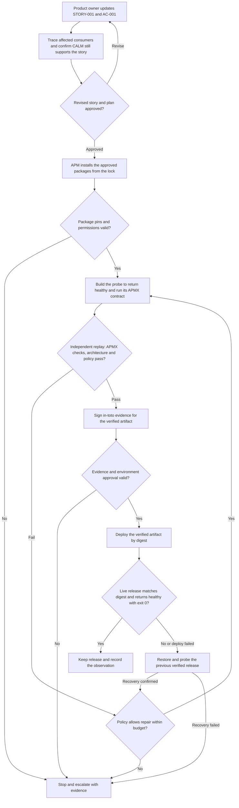
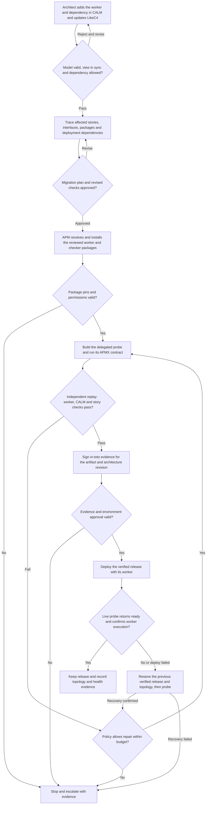

# Forge Kit

## Executive summary

**Forge Kit is an open-source software factory that helps teams turn a requested software change into a release they can trust.** A product team might ask for a new way to sort search results, or an engineering team might change how a service works behind the scenes. Both changes follow the same path.

1. **Agree on the change.** The team describes what should improve, what must keep working, and how to tell whether the change succeeded.
2. **Plan and build it.** Forge Kit works out what the request affects, brings together the tools needed for the job, and produces a version for review.
3. **Check it independently.** A separate check confirms that the new version does what the team asked and still follows the rules for how the software is built. A failed check holds the release back.
4. **Approve and release it.** Reviewers can see the request, the checks that passed, and the version being released. The approved version goes live and is checked again where people use it.
5. **Recover if something goes wrong.** The factory is designed to restore the last working version, try a limited repair when the rules allow it, and bring in an operator if recovery fails. A repaired version goes through the same checks before release.

This is the target for Forge Kit. The [reference implementation](#try-the-reference-implementation) demonstrates parts of the process today.

## Who uses it

| Factory user | What they do |
| --- | --- |
| Product owners | Define outcomes as epics, features, and stories with stable, executable acceptance criteria. Review how a proposed release changes product behavior. |
| Architects | Update the system model and review which components, dependencies, and contracts a change affects. Approve changes to architecture constraints. |
| Engineering and platform teams | Maintain the capability catalog, plan and implement changes, and define independent checks and release policies. |
| Release operators | Review release evidence, approve promotion where required, and use runtime observations to confirm recovery or investigate an escalation. |

## How the factory fits together

| Component | Responsibility and handoff |
| --- | --- |
| **Product requirements** | An Epic → Feature → Story hierarchy connects an outcome to an owning architecture node. Stable Given/When/Then acceptance IDs give planners and checkers a shared contract for expected behavior. |
| **FINOS CALM and LikeC4** | CALM is the authoritative, machine-readable model of components, relationships, and constraints. LikeC4 gives reviewers a readable view of that model. The factory checks that the view agrees with CALM and uses the model to scope affected stories, services, and checks. |
| **APM (Agent Package Manager)** | Resolves and installs the factory's reviewed external capabilities, including agents, skills, workflow primitives, MCP configuration, policies, and checkers. `apm.yml` declares dependencies and `apm.lock.yaml` records the exact resolved versions, including transitive dependencies, for reproducible setup. |
| **APMX (contract runner)** | Runs pinned Markdown contracts that declare required inputs, expected outputs, and executable checks. APMX invokes an agent harness for agent tasks. In a separate job, the verifier can use `apmx check` to replay the checks against recorded outputs without an agent. |
| **GitHub Actions and GitHub Agentic Workflows (GH-AW)** | Actions coordinates isolated jobs and artifact handoffs. Agentic workflows give agents scoped planning, implementation, and repair tasks. GitHub review and environment rules control changes and release access. |
| **TypeSafe Jev and deterministic policy** | Jev supplies typed recommendations, such as retry or escalate. Factory policy checks the response schema, allowed actions, confidence, and remaining attempts, time, and spend. Missing, invalid, or low-confidence signals escalate. Passing verification and release approval are separate gates. |
| **Independent verification and in-toto evidence** | A separate checker uses approved inputs and its own acceptance oracle to test behavior, architecture compliance, security, policy, and package integrity. Trusted signing produces in-toto evidence binding the candidate digest to requirements, architecture, the package lock, decisions, check results, and rejected attempts. |
| **Delivery and runtime self-healing** | A gated delivery adapter checks the attestation, signer, and artifact digest before deploying the verified bytes. Runtime probes confirm release identity and behavior. If a release fails, the factory restores and probes the last known-good release. Policy can allow a bounded repair, which goes through independent verification and approval again. Failed recovery or an exhausted budget goes to an operator. |

The producer, checker, attestor, and deployer have distinct permissions. The checker gets approved requirements, architecture, and test definitions from trusted revisions, with the producer supplying the candidate. This keeps the producer from changing the rules by which its own work is accepted. [Detailed architecture](docs/architecture.md)

## Software supply chain and SLSA

SLSA (Supply-chain Levels for Software Artifacts) gives teams a way to assess whether a release came from the expected source and build process, and whether the delivered files match the evidence. Forge Kit applies several SLSA Build Track concepts. [SLSA Build Track basics](https://slsa.dev/spec/v1.2/build-track-basics)

- **Known build inputs.** The APM lock pins package revisions, and hosted workflows and APMX contracts use reviewed commit references. The factory records hashes of the inputs it checked.
- **Build provenance.** APMX records how outputs were produced and identifies them by digest in an in-toto receipt. Provenance describes the build. Test results describe what was checked and whether it passed. [SLSA Build Provenance](https://slsa.dev/spec/v1.2/build-provenance)
- **Separate verification and signing.** The hosted reference replays checks in a separate GitHub Actions job before signing an APMX receipt bundle and a SLSA Verification Summary Attestation. The summary records the verification result and binds it to the delivered files. [APMX signing action](https://github.com/danielmeppiel/apmx/blob/fae2067a0dc6ff07beda714015ff9e648f41ce63/.github/actions/attest/action.yml)
- **Evidence before delivery.** The hosted Pages rehearsal waits for the signing job and checks the live files against the release manifest. The target release gate also verifies the signature, trusted workflow identity, expected build inputs, and artifact digest before deployment. [Hosted rehearsal](docs/hosted-rehearsal.md) · [SLSA artifact verification](https://slsa.dev/spec/v1.2/verifying-artifacts)

The local fixture emits an unsigned in-toto receipt. The hosted verification summary records a pass and leaves the SLSA level field empty. A Build Track level claim would require assessing the specific build and release path against the relevant requirements, including provenance generation, distribution, and build platform controls. [SLSA Build requirements](https://slsa.dev/spec/v1.2/build-requirements)

## When a factory user changes product requirements

A product owner changes `STORY-001` so the readiness probe prints `healthy` instead of `ready`, with exit code zero. The existing architecture still supports the story. Impact analysis traces the changed acceptance criterion to `health_probe` and identifies consumers that rely on the old response. The checker tests the new behavior against the approved story revision.



## When a factory user changes architecture

An architect moves readiness execution from `health_probe` into a separate `readiness_worker`. The CALM model gains a directed dependency from the probe to the worker, and the LikeC4 view shows the same relationship. The approved product behavior stays `ready` with exit code zero in this example. The checker also requires evidence that the worker actually ran, so a direct implementation that prints the expected output still fails.



In both examples, a rejected candidate stays out of the target environment. Repair starts from the approved inputs and uses Jev only as an advisory signal. If a repair needs a different requirement, architecture, or package set, it goes back through review and assembly before another build.

## Try the reference implementation

The deterministic Node.js 20+ fixture runs offline by default. It checks the CALM and LikeC4 inputs, builds and checks a small readiness program, copies the accepted bytes to a local deployment path, and runs the deployed program. The faulty-build case demonstrates one repair attempt. The local in-toto Statement is unsigned. The verifier re-hashes the inputs and artifacts and replays acceptance against the approved fixture.

Use fresh output directories for each run.

```sh
node --test
node factory/cli.mjs assemble
node factory/cli.mjs run out/clean
node factory/cli.mjs verify out/clean
node factory/cli.mjs run out/repaired --faulty-first-build
node factory/cli.mjs verify out/repaired
```

- **Factory bootstrap** runs the reference checks and replays acceptance in a separate job. The optional Pages drill publishes a synthetic candidate, probes the live release, and restores the verified baseline. [Hosted rehearsal](docs/hosted-rehearsal.md)
- **APMX package rehearsal** exercises a pinned execution contract, an independent check, and signed evidence. **Catalog reference rehearsal** calls the pinned GH-AW workflow and exercises a separate signed handoff, local promotion, rollback, and one repair. [APMX workflow](.github/workflows/apmx-rehearsal.yml) · [Catalog workflow](.github/workflows/catalog-rehearsal.yml)
- **Optional Jev routing** uses `FORGE_JEV_TOKEN` to opt into a live choice call on an eligible fixture rejection. The fixture permits one retry at a selected-label probability of at least 0.8. [TypeSafe decision API](https://github.com/TypeSafeAI/typesafe-router/blob/main/REFERENCE.md)

The rehearsals demonstrate separate parts of the target. Integrating live APMX execution with production delivery, establishing durable signer identities, and operating a production telemetry and repair loop remain open work. [Implementation status](docs/implementation-status.md)

## Explore or extend the factory

**Forge Factory E2E** is the GitHub Actions entry point for a selected product story. A pinned GitHub Agentic Workflow calls the factory worker, which builds the story, runs and independently replays its APMX contract, signs the evidence, and can publish the public reference to Pages. The workflow uses `COPILOT_GITHUB_TOKEN`. See the [hosted runbook](docs/hosted-rehearsal.md) for inputs, artifacts, and the older catalog rehearsal.

- Author stories and trace their acceptance IDs through a run. [Product requirements guide](docs/product-requirements.md)
- Review the required scenarios and expected evidence, then run the existing verification suite. [Factory test plan](factory/test/README.md) · [Verification and evals](docs/testing.md)
- Inspect the capability roles and immutable references with `node factory/cli.mjs assemble`. When changing a package, review its source, transitive pins, permissions, and install effects. Regenerate the manifest with `node factory/cli.mjs assemble --apm`, refresh the lock, and update the caller's pinned workflow reference if orchestration changes. CI checks that APM 0.33.0 can reproduce the install with `apm install --target copilot --frozen`. [Capability manifest](factory/packages.json) · [APM manifest](apm.yml) · [APM lock](apm.lock.yaml) · [Skills catalog](https://github.com/richgo/forge-kit-skills)
