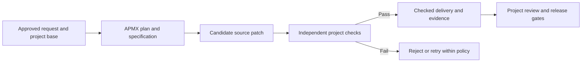

# ForgeKit

ForgeKit is a CLI-native, language-agnostic software factory. It turns an approved product or architecture request into a source patch that a project's independent checks can accept for review. APM installs versioned capabilities, and APMX runs the contracts that turn the request into a plan, specification, implementation and review.

The project owns its language, toolchain, architecture, acceptance criteria and release policy. ForgeKit defines the handoffs between the agent that proposes a change, the verifier that checks it and the operator who can authorize publication.



## Start with a project

1. Install the [consumer blueprint](blueprint/README.md#install-in-an-application-repository) in your project. Author behavior and acceptance criteria in [product-requirements.md](blueprint/product-requirements.md). Select the approved stories and source paths in [request.md](blueprint/request.md) and configure the project-owned `.forge/verify-change` checker. The template exits unsuccessfully until you supply real checks.
2. Install APMX 0.8.0 and the Copilot CLI. Inspect the pinned contract graph from a clean copy of the reviewed project.

   ```sh
   apmx --from "richgo/forge-kit-skills/packages/software-factory#40a7a6b54ce5603f450e4935beb9dac4f466b95a" --plan
   ```

3. Follow the [APMX runbook](docs/apmx-factory.md) to run with an agent or configure GitHub Actions for independent replay and attestation. Review the exact patch and the evidence before accepting the change.

## Explore the examples

| Example | What to exercise |
| --- | --- |
| [Python quote API, Go quote service and TypeScript price calculator](examples/consumers/README.md) | One approved discount behavior across three toolchains. Each project supplies its own protected checks for an unapplied source patch. |
| [Trail Desk](docs/hosted-rehearsal.md) | Trace a product story through CALM, LikeC4 and browser acceptance, then inspect the evidence for a protected Pages release. |
| [Readiness fixture](docs/testing.md#readiness-and-catalog-fixtures) | Inject a faulty implementation and replay independent acceptance against the repaired result. |

## Documentation

- [Architecture](docs/architecture.md) and [components](docs/components.md) explain the lifecycle, interfaces and trust boundaries.
- [User guide](docs/user-guide.md) and [product requirements](docs/product-requirements.md) describe how to propose, build and review a change.
- [Verification guide](docs/testing.md) and [test catalog](factory/test/README.md) explain how to exercise and interpret the checks.
- [Implementation status](docs/implementation-status.md) records which paths are runnable and what each qualification covers.
